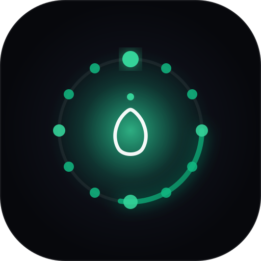

# 📿 জিকির (Zikr) — প্রশান্তিময় ডিজিটাল তাসবীহ

> **শান্ত, মার্জিত ও মিনিমালিস্ট ডার্ক তাসবীহ ও জিকির ওয়েব অ্যাপ্লিকেশন (PWA)**  
> মনোযোগ ও প্রশান্তির সাথে প্রতিদিনের জিকির আদায় ও ক্যালেন্ডার-সিঙ্কড হিস্ট্রি ট্র্যাকিংয়ের একটি আধুনিক মাধ্যম।



---

## 🌟 মূল বৈশিষ্ট্যসমূহ (Features)

- **মিনিমালিস্ট ও ডিপ ডার্ক ডিজাইন (Obsidian Minimal Dark)**:
  - রাতের বেলা চোখ যাতে আরাম পায় এবং কোনো প্রকার অনাকাঙ্ক্ষিত বিঘ্ন (distraction) ছাড়া একাগ্রতার সাথে জিকির করা যায়।
  - ৪টি শান্ত এক্সেন্ট কালার প্যালেট: **মরু সবুজ (Emerald)**, **উষ্ণ আম্বার (Amber/Gold)**, **মার্জিত রূপালি (Silver/White)**, এবং **শান্ত আকাশী (Cyan)**।
- **গোলাকার কাউন্টার বাটন ও মসৃণ প্রগ্রেস রিং**:
  - সেন্টারের বড় বাটনে ট্যাপ করলেই কাউন্ট বৃদ্ধি পায়।
  - চারপাশে ডায়নামিক **SVG Circular Progress Ring** তাৎক্ষণিক লক্ষ্যমাত্রার অগ্রগতি দেখায়।
- **দ্বিভাষিক সমর্থন (Bilingual বাংলা & English)**:
  - এক ক্লিকেই পুরো অ্যাপ বাংলা বা ইংরেজি ভাষায় ব্যবহার করা যায়।
  - সংখ্যার ফরম্যাট পরিবর্তন: **বাংলা ডিজিট (১, ২, ৩)** অথবা **ইংরেজি ডিজিট (1, 2, 3)**।
- **কাস্টম জিকির ও কাস্টম টার্গেট**:
  - পূর্বনির্ধারিত ৮টি জনপ্রিয় জিকির।
  - নিজের ইচ্ছামতো যেকোনো নতুন জিকির (বাংলা/ইংরেজি নাম, আরবি হরফ, তাৎপর্য এবং ৩৩, ১০০, ৫০০ বা সীমাহীন টার্গেট) যুক্ত করার সুবিধা।
- **📅 ক্যালেন্ডার ডেট-সিঙ্কড স্ট্যাটিস্টিকস (Calendar Analytics)**:
  - কোন দিন কতটুকু কোন জিকির করা হয়েছে তার সম্পূর্ণ দৈনিক ব্রেকডাউন।
  - শুরু করার তারিখ এবং মোট অতিবাহিত দিনের হিসাব।
  - স্ট্রিক ট্র্যাকার (Current Streak ও Best Streak)।
  - লাইফটাইম সর্বমোট জিকির সংখ্যা এবং টার্গেট রাউন্ড/ল্যাপ ট্র্যাকিং।
- **সাউন্ড ও হ্যাপটিক ভাইব্রেশন**:
  - Web Audio API সিন্থেসাইজার: কাঠের তাসবীহ (Wood), মেকানিক্যাল ক্লিক (Click), মেডিটেশন বেল (Bell), এবং জলবিন্দু (Water)।
  - হেডারের স্পিকার বাটনে এক ক্লিকেই সাউন্ড অন/অফ (Mute/Unmute) করার ব্যবস্থা।
  - মোবাইল ডিভাইসে বাস্তব বোতামের স্পর্শ অনুভূতি দিতে Haptic Vibration।
- **জেন মোড (Zen Mode)**:
  - সমস্ত মেনু ও বাটন লুকিয়ে ফুলস্ক্রিন ডিসপ্লেতে শুধুমাত্র কাউন্টার নিয়ে একাগ্র জিকির।
  - কী-বোর্ডের **Spacebar** চেপে গণনা এবং **ESC** চেপে প্রস্থান।
- **📱 PWA ও সম্পূর্ণ অফলাইন সাপোর্ট (Progressive Web App)**:
  - Android ও iOS ডিভাইসে কোনো অ্যাপ স্টোর ছাড়াই হোমস্ক্রিনে ইনস্টলযোগ্য।
  - ইন্টারনেট সংযোগ ছাড়াও অফলাইনে ১০০% কাজ করে।
- **ডাটা ব্যাকআপ ও রিস্টোর**:
  - সমস্ত জিকির ইতিহাস ও কাস্টম সেটিংস JSON ফরম্যাটে ডাউনলোড ও রিস্টোর করার পূর্ণ ব্যবস্থা।

---

## 🛠️ প্রযুক্তি (Tech Stack)

- **Framework**: [Next.js](https://nextjs.org/) (App Router, React 19, TypeScript)
- **Styling**: [Tailwind CSS](https://tailwindcss.com/)
- **Animations**: [Framer Motion](https://www.framer.com/motion/) & [Canvas Confetti](https://github.com/catdad/canvas-confetti)
- **Icons**: [Lucide React](https://lucide.dev/)
- **Audio & Haptics**: Web Audio API & HTML5 Vibration API
- **PWA & Cache**: Service Worker (`sw.js`) & Web App Manifest

---

## 🚀 লোকাল সেটআপ ও রান করার নিয়ম (Getting Started)

১. রিপোজিটরি ক্লোন করুন:
```bash
git clone https://github.com/shahriarmehedi/zikr.git
cd zikr
```

২. ডিপেন্ডেন্সি ইনস্টল করুন:
```bash
npm install
```

৩. ডেভেলপমেন্ট সার্ভার চালু করুন:
```bash
npm run dev
```
ব্রাউজারে [http://localhost:3000](http://localhost:3000) ওপেন করুন।

৪. প্রোডাকশন বিল্ড তৈরি করতে:
```bash
npm run build
npm run start
```

---

## 📱 PWA হিসেবে মোবাইল বা কম্পিউটারে ইনস্টল করা
- **Android (Chrome)**: ব্রাউজারের ৩-ডট মেনু থেকে **"Add to Home Screen"** বা স্ক্রিনে প্রদর্শিত ইনস্টল ব্যানারে ক্লিক করুন।
- **iPhone / iPad (Safari)**: শেয়ার (Share) বাটনে ট্যাপ করে **"Add to Home Screen"** নির্বাচন করুন।
- **Chrome / Edge (Desktop)**: অ্যাড্রেস বারের ডানপাশে থাকা Install আইকনটিতে ক্লিক করুন।

---

## 📄 লাইসেন্স
MIT License • প্রশান্তিময় জিকির ও নেক আমলে সবার উপকারে আসুক।
